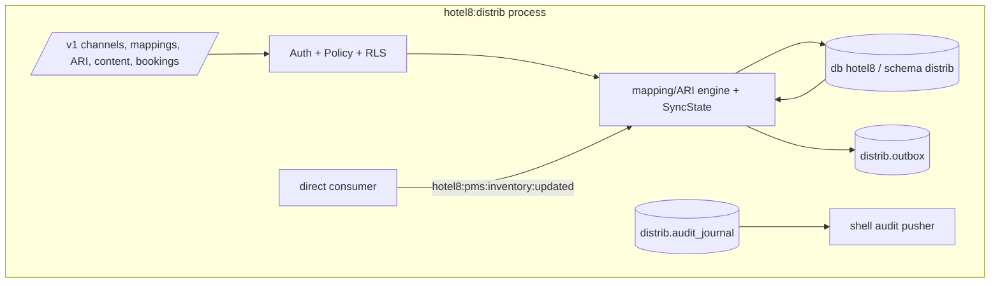

# README.md: Hotel8:Distrib - Channel Distribution

## 1. Summary

Hotel8:Distrib is the channel-distribution service of the hotel8 vertical.
It registers distribution channels (OTAs, GDS, wholesalers, corporate,
metasearch), maps channel-side properties/room types/rate plans to PMS
inventory, publishes availability/rate/controls (ARI) with per-channel
markups and edit windows, receives reservations from channels, and keeps a
full sync ledger for reconciliation.

## 2. Motivation

Channel selling needs a disciplined translation layer: channel-side
identifiers differ from hotel identifiers, availability changes must
propagate quickly to many partners, and each channel has its own edit
windows and content rules. Distrib isolates that translation from PMS so the
property management core stays channel-agnostic while distribution strategy
remains tenant-configurable.

## 3. Architecture & High-Level Design

Shell-owned construction; the direct consumer reacts to PMS inventory changes
by republishing per-mapping ARI; SyncState machinery tracks delivery.

## 4. Key Traits and Data Structures

- `SyncState` - pure state machine over the `sync_status` enum labels
  (pending → synced/failed/retry); sync attempts are replayable from
  `distrib.sync_log`.
- Channel-property/room-type/rate-plan mappings - the translation tables
  that make PMS inventory speak channel dialects.
- `Publisher` - caller identity for outbox rows.

## 5. Rationale, Trade-offs, and Alternatives

- **Mappings as first-class rows** - audit-friendly, tenant-editable,
  testable; in-code translation would couple channel onboarding to deploys.
- **ARI push with idempotent inventory updates** - channel redelivery is
  safe; the updates table records every push for dispute support.
- **Event-first republication** - PMS inventory ticks republish instantly;
  polling channels' changes would lag sales.
- **Channel partner ReBAC edges** - per-channel ARI edit windows are
  tenant-authored policy (ABAC), keeping commercial terms out of code.

## 6. Internal Implementation & Invariants (Private Design)

- Booking intake writes the reservation with its channel reference and emits
  `reservation:received` - never mutates PMS directly (PMS owns inventory).
- Sync retries are capped and logged; exhausted rows stay for manual replay.
- Rate markups/markdowns are stored per channel-property with their
  commercial context; the computed channel rate is deterministic.
- No `unsafe` code.

## 7. Unresolved Questions / Future Designs

- Two-way content sync beyond the current push model.
- Per-channel rate-parity monitors.

---

**Design attribution:** hotel8:distrib and its underlying concepts were designed by Hamid Jahanzad <Hamid@Jahanzad.com>.
